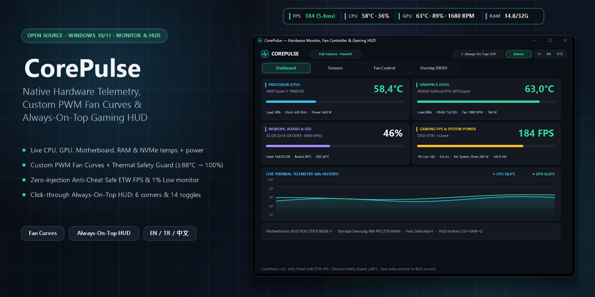
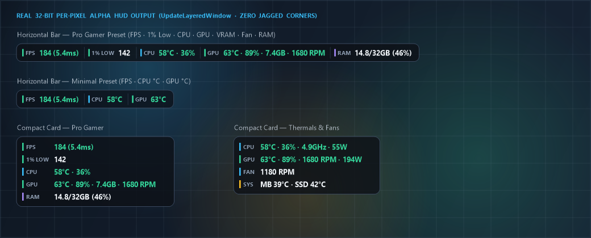
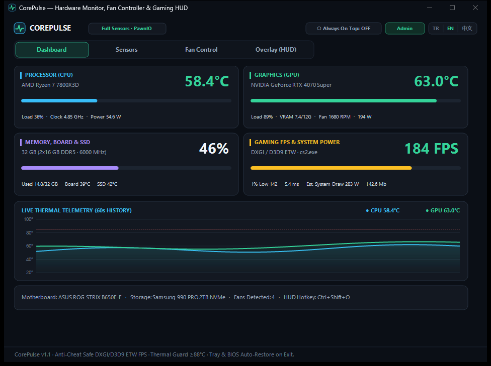
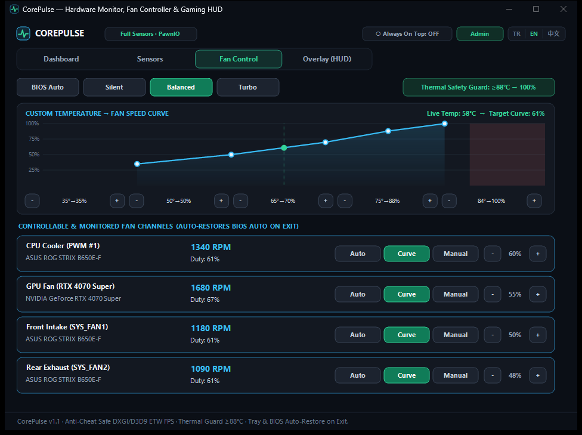
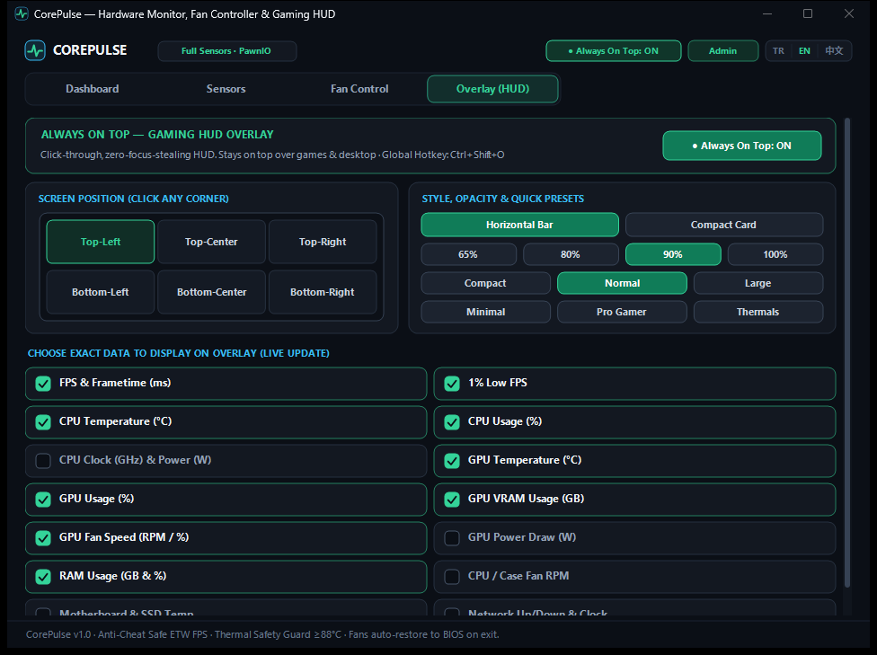
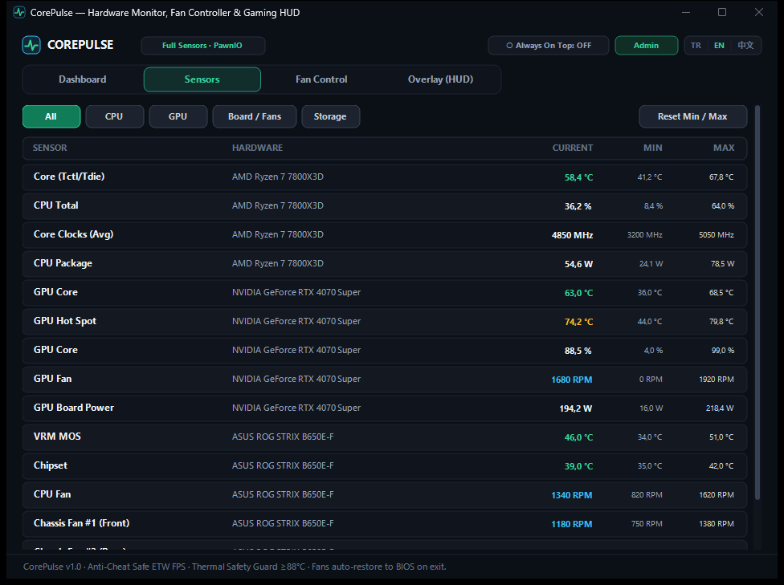
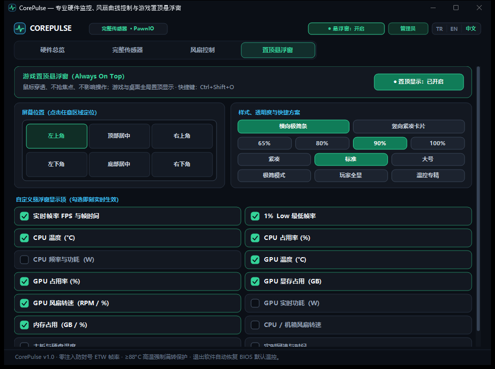
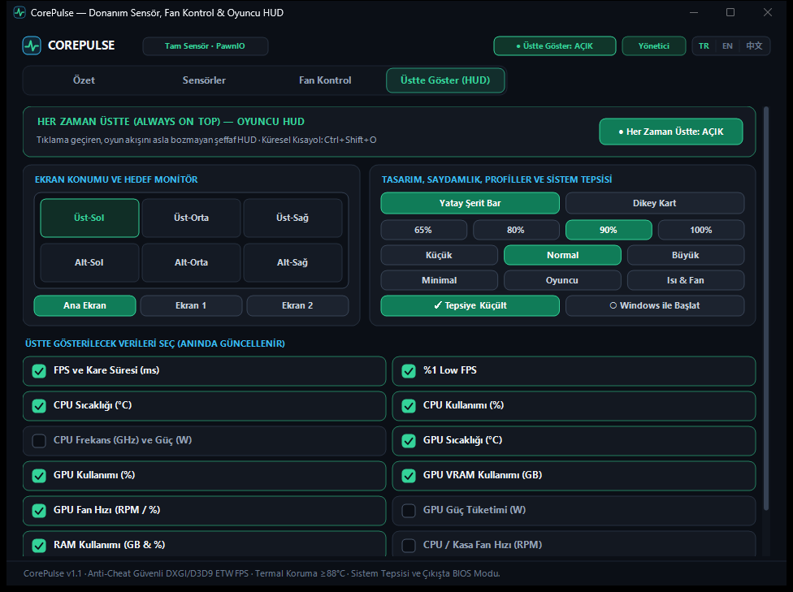

<p align="center">
  
</p>

<h1 align="center">CorePulse</h1>

<p align="center">
  <strong>A lightweight, native Windows 10/11 hardware monitor, custom PWM fan curve controller with thermal safety guard, zero-injection DXGI/D3D9 QPC ETW FPS counter, System Tray daemon, and 32-bit per-pixel alpha Always-On-Top Gaming HUD.</strong>
</p>

<p align="center">
  
  
  
  
  <a href="https://linux.do"></a>
</p>

<p align="center">
  <b>English</b> &nbsp;·&nbsp; <a href="README.zh-CN.md"><b>简体中文</b></a> &nbsp;·&nbsp; <a href="#türkçe"><b>Türkçe</b></a> &nbsp;·&nbsp; <a href="https://github.com/rodvay/CorePulse/releases/latest"><b>Download Portable ZIP (v1.2.0)</b></a>
</p>

---

## Key Features

- **Full Hardware Telemetry Dashboard & 60s Thermal Graph:** Real-time CPU Temp/Load/Clock/Power, **Discrete GPU priority** (never overwritten by iGPU on hybrid laptops/desktops) with **true 64-bit Dedicated VRAM** (bypasses the 4 GB 32-bit WMI cap and ignores D3D Shared RAM), GPU Core & Hotspot Temp/Fan RPM/Power, Motherboard VRM/Chipset Temps, RAM Specs & Usage, NVMe/SSD Temp, and Network/System Power telemetry.
- **Custom PWM Fan Curve Controller + Thermal Safety Guard + Startup Auto-Restore:** Auto-discovers controllable Motherboard CPU/Case/AIO PWM headers & GPU fans via official **LibreHardwareMonitor v0.9.6 + signed WHQL PawnIO** (zero deprecated `WinRing0` alerts!). Includes **BIOS Auto / Silent / Balanced / Turbo** presets, an interactive 5-point Temp → Duty% curve editor, automatic saved profile restoration on launch, mandatory **≥88°C CPU / ≥83°C GPU → 100% emergency override**, and automatic **BIOS Auto restore on exit**.
- **32-bit Per-Pixel Alpha Always-On-Top Gaming HUD (`Ctrl+Shift+O`):** Rendered with Win32 **`UpdateLayeredWindow` (`ULW_ALPHA`)** for glass-smooth anti-aliased rounded corners (zero jagged `TransparencyKey` halos!) and true click-through non-activating flags (`WS_EX_TOPMOST | WS_EX_TRANSPARENT | WS_EX_NOACTIVATE`). Choose your **target display on multi-monitor rigs**, pick any of **6 screen anchors**, **Horizontal Bar** or **Compact Card** layout, opacity & scale, and toggle **14 individual metrics**.
- **Zero-Injection Anti-Cheat-Safe Real FPS Counter (DXGI + D3D9):** Uses exact hardware **QPC (`EventHeader.TimeStamp`)** from native Windows **ETW (`Microsoft-Windows-DXGI` & `Microsoft-Windows-D3D9`)** to measure true **FPS, 1% Low FPS, and Frametime (ms)** immune to 1s ETW buffer flush batching — injects zero DLLs into games.
- **System Tray Resident Mode, Single-Instance Protection & Sleep/Wake Recovery:** Close-to-Tray keeps your PWM Fan Curves and Gaming HUD running silently in the background with live tray hover telemetry (`CPU/GPU °C · FPS`), quick right-click Fan Profile & HUD toggles, optional `Start with Windows` (`--minimized`), single-instance tray wakeup (double-clicking `CorePulse.exe` restores the existing window cleanly without conflicting fan/ETW sessions), automatic fan curve re-application after Sleep/Resume, display hotplug HUD re-anchoring, and 100% safe fallback even if `lib\` DLLs are missing.
- **Smart OS Language Auto-Detection (`EN` / `TR` / `简体中文`):** Launches automatically in Turkish on Turkish Windows, Simplified Chinese on Chinese Windows, and English everywhere else, with clean locale-independent numeric formatting (`58.4°C`, `4.85 GHz`).

---

## Live 32-bit Glass HUD Output

<p align="center">
  
</p>

## App Screenshots

<table>
  <tr>
    <td align="center" width="50%">
      <br />
      <sub><b>Dashboard</b> — Hero CPU/GPU/RAM/FPS cards & 60s dual thermal sparkline graph</sub>
    </td>
    <td align="center" width="50%">
      <br />
      <sub><b>Fan Control</b> — Interactive Temp → Fan% curve, per-channel Auto/Curve/Manual & ≥88°C guard</sub>
    </td>
  </tr>
  <tr>
    <td align="center" width="50%">
      <br />
      <sub><b>Overlay (HUD) Tab</b> — 6-corner & Multi-Monitor picker, Tray/Startup toggles & 14 metrics</sub>
    </td>
    <td align="center" width="50%">
      <br />
      <sub><b>Sensors Tab</b> — Categorized live Current / Min / Max readings with 1-click reset</sub>
    </td>
  </tr>
  <tr>
    <td align="center" width="50%">
      <br />
      <sub><b>简体中文界面</b> — Native Microsoft YaHei UI localization</sub>
    </td>
    <td align="center" width="50%">
      <br />
      <sub><b>Türkçe Arayüz</b> — Çoklu monitör, tepsiye küçültme ve Always On Top HUD ayarları</sub>
    </td>
  </tr>
</table>

---

## Quick Start & Driver Note

1. Download **`CorePulse-v1.1.2-Portable.zip`** from **[Releases](https://github.com/rodvay/CorePulse/releases/latest)**, extract it, and run **`CorePulse.exe`**.
2. **For full CPU Package Temp, Motherboard VRM/Case Fan Control & ETW FPS:**
   - Install the official WHQL-signed **[PawnIO Driver](https://github.com/namazso/PawnIO.Setup/releases/latest)** (the modern signed replacement for legacy `WinRing0`, also linked directly inside CorePulse) and click **Admin ↗** in the top bar.
   - Even without Admin/PawnIO — or even if `CorePulse.exe` is run standalone without `lib\` — CorePulse launches cleanly with zero crashes and degrades gracefully to native telemetry.
3. **Gaming Overlay Tip:** Works cleanly above Borderless Windowed and Windows 11 DX12 Flip-Model games (zero latency penalty on Windows 11). Press **`Ctrl + Shift + O`** anytime to toggle the HUD on/off.

## Building from Source

Requires only Windows 10/11 (uses inbox `.NET Framework 4.x` `csc.exe`; `build.bat` automatically downloads official `LibreHardwareMonitor v0.9.6` runtime DLLs into `lib\`):

```bat
git clone https://github.com/rodvay/CorePulse.git
cd CorePulse
build.bat
```

---

<a id="türkçe"></a>

## Türkçe Özet

**CorePulse v1.1**, Windows 10/11 için geliştirilmiş düşük kaynak tüketimli, yerli donanım sıcaklık/yük monitörü, **özel PWM Fan Eğrisi denetleyicisi**, anti-cheat güvenli **DXGI/D3D9 QPC ETW FPS sayacı**, **Sistem Tepsisi (Tray)** destekli arka plan servisi ve **32-bit cam şeffaflıklı Always On Top Oyuncu HUD** yazılımıdır.

- **4 Sekme:** **Özet** (harici GPU öncelikli ve gerçek 64-bit Dedicated VRAM destekli CPU/GPU/RAM/FPS kartları + 60 sn canlı sıcaklık grafiği), **Sensörler** (Anlık/Min/Maks tam liste), **Fan Kontrol** (BIOS Otomatik / Sessiz / Dengeli / Turbo, etkileşimli 5 noktalı fan eğrisi, açılışta kayıtlı profili otomatik yükleme, ≥88°C otomatik %100 termal koruma ve çıkışta BIOS'a dönüş) ve **Üstte Göster (HUD)** (çoklu monitör hedef ekran seçimi, 6 ekran köşesi, Yatay Bar veya Dikey Kart, Tepsiye Küçültme & Windows ile Başlatma, 14 ayrı sensör kutucuğu, küresel kısayol `Ctrl+Shift+O`).
- **Otomatik 3 Dil:** Türkçe Windows'ta Türkçe, Çince Windows'ta Basitleştirilmiş Çince, diğer dillerde İngilizce açılır (`TR | EN | 中文`).
- **İndirme:** **[Releases](https://github.com/rodvay/CorePulse/releases/latest)** sayfasından `CorePulse-v1.1.2-Portable.zip` dosyasını indirip klasöre çıkartarak `CorePulse.exe` dosyasını çalıştırabilirsiniz.

> 简体中文完整文档请查看 **[README.zh-CN.md](README.zh-CN.md)**。

---

## Community & Links

- Friendly community link & discussion: **[LINUX DO](https://linux.do)** — Thank you to the LINUX DO open-source community for the feedback and support!
- Powered by **[LibreHardwareMonitorLib](https://github.com/LibreHardwareMonitor/LibreHardwareMonitor)** (`v0.9.6`) & signed **[PawnIO](https://github.com/namazso/PawnIO.Setup)**.

## License

Licensed under the **MIT License** — see [LICENSE](LICENSE) for details.
