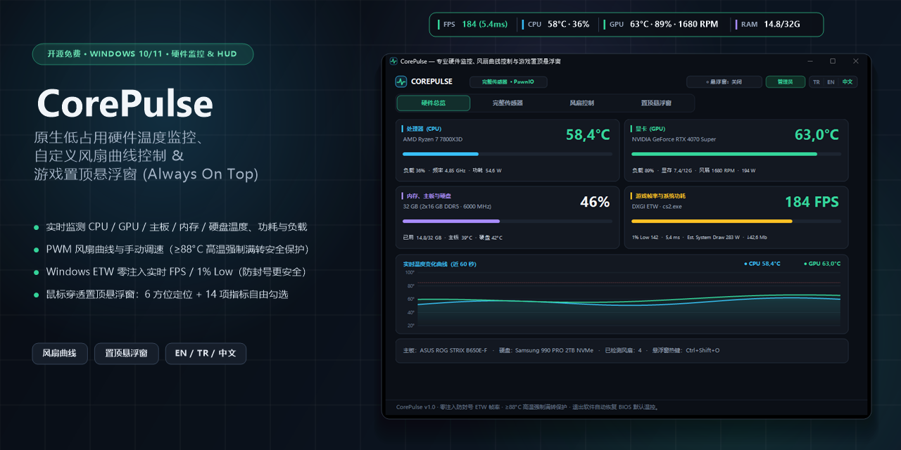
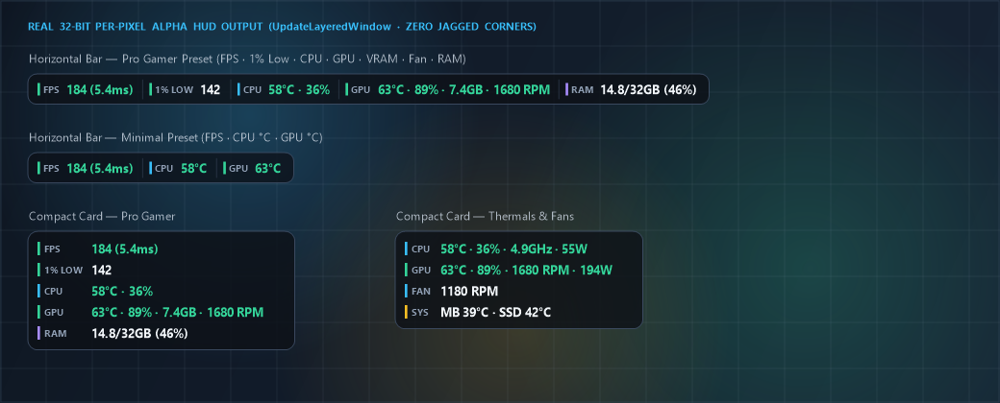
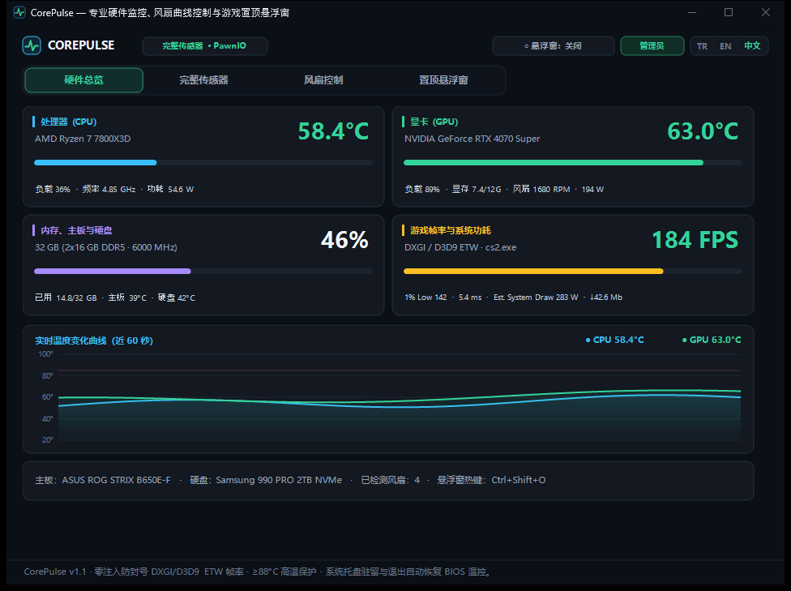
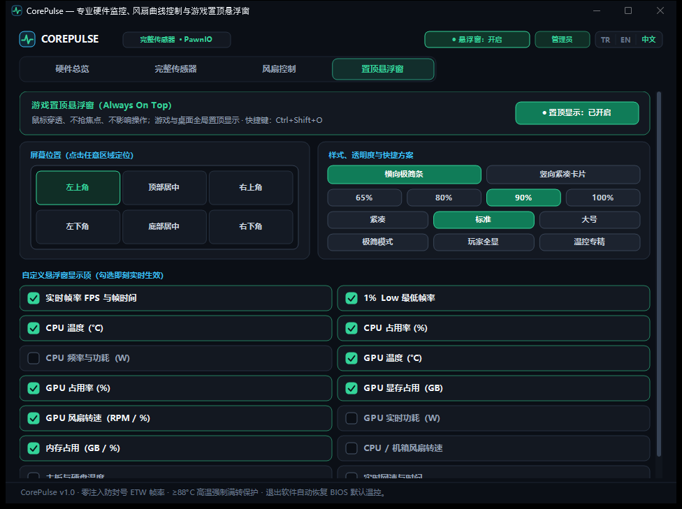
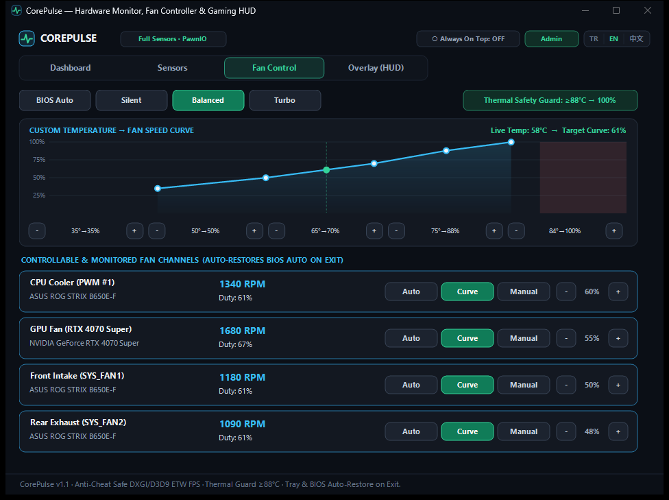
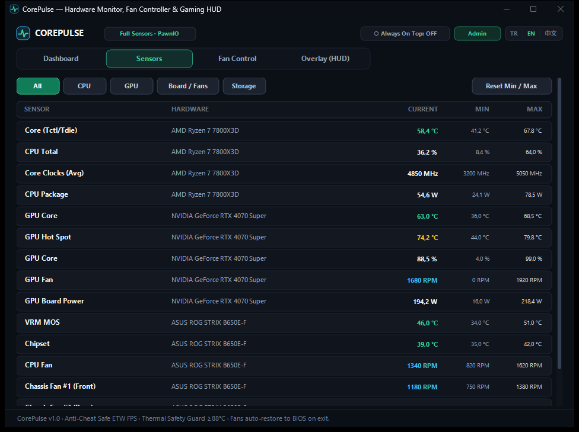

<p align="center">
  
</p>

<h1 align="center">CorePulse — 硬件监控、风扇曲线与 32-bit 游戏置顶 HUD</h1>

<p align="center">
  <strong>轻量原生 Windows 10/11 全硬件温控与玩家悬浮窗工具：集独显优先全硬件监控、自定义 PWM 风扇曲线（含 ≥88°C 高温保护与托盘驻留）、零注入 QPC DXGI/D3D9 ETW 实时 FPS 与多屏 32-bit 逐像素透明置顶 HUD 于一体。</strong>
</p>

<p align="center">
  
  
  
  
  <a href="https://linux.do"></a>
</p>

<p align="center">
  <a href="README.md"><b>English</b></a> &nbsp;·&nbsp; <b>简体中文</b> &nbsp;·&nbsp; <a href="README.md#türkçe"><b>Türkçe</b></a> &nbsp;·&nbsp; <a href="https://github.com/rodvay/CorePulse/releases/latest"><b>下载便携版 (v1.2.0)</b></a>
</p>

---

## 核心特色

- **独显优先全硬件监控与 60 秒温度曲线**：同步监测 CPU 温度/占用/频率/功耗、**独立显卡优先**（避免双显卡笔记本/台式机被核显覆盖）+ **64 位真实专用显存**（突破 4 GB 上限并排除 D3D 共享内存误报）、GPU 核心与热点温度/风扇转速/功耗、主板 VRM/芯片组温度、内存规格与占用、NVMe 硬盘温度及实时网速；即便缺少 `lib\` 外部依赖亦可安全降级零崩溃运行。
- **自定义 PWM 风扇曲线 + 系统托盘驻留 + 高温保护**：基于官方 **LibreHardwareMonitor v0.9.6 + 微软签名 PawnIO 驱动**（彻底告别老旧 WinRing0 误报），提供 **BIOS 自动 / 静音 / 均衡 / 强冷** 方案及 5 点可视化温度曲线，重启自动恢复上次保存的风扇设置；支持**关闭驻留系统托盘**（悬停实时显示 CPU/GPU 温度与 FPS，右键切换风扇方案/开关 HUD）与**开机静默自启**；内置 **CPU ≥88°C 或 GPU ≥83°C 强制 100% 满转**保护，退出时自动恢复 BIOS 默认温控。
- **32-bit 逐像素透明 Always On Top 悬浮窗（`Ctrl+Shift+O`）**：采用 Win32 **`UpdateLayeredWindow` (`ULW_ALPHA`)** 渲染丝滑抗锯齿圆角（无黑边锯齿），真正鼠标穿透不抢焦点；支持**多显示器指定屏幕**、**6 个屏幕方位**、**横向极简条 / 竖向卡片**、透明度/字号及 **14 项指标独立开关**。
- **零注入防封号 QPC ETW 真实帧率（DXGI + D3D9）**：使用 Windows 原生 ETW 硬件高精度 QPC 时间戳同时监听 **DXGI（DX10/11/12/Vulkan）与 D3D9** 真实呈现事件，精准计算 **FPS、1% Low 与帧时间 (ms)**，不受缓冲批量刷新影响，绝不向游戏注入 DLL。
- **自动三语适配**：中文 Windows 默认启动**简体中文**，支持顶部 **`TR | EN | 中文`** 实时切换，统一清爽小数点显示格式。

---

## 真 32-bit 逐像素透明悬浮窗实拍效果

<p align="center">
  
</p>

## 软件界面预览

<table>
  <tr>
    <td align="center" width="50%">
      <br />
      <sub><b>硬件总览</b> — CPU / GPU / 内存 / 实时 FPS 卡片与 60 秒双温度曲线</sub>
    </td>
    <td align="center" width="50%">
      <br />
      <sub><b>置顶悬浮窗 (Always On Top)</b> — 多显示器、6 方位定位、托盘/自启与 14 项指标开关</sub>
    </td>
  </tr>
  <tr>
    <td align="center" width="50%">
      <br />
      <sub><b>风扇控制</b> — 5 点可视化温控曲线 + 分通道自动/曲线/手动调速</sub>
    </td>
    <td align="center" width="50%">
      <br />
      <sub><b>完整传感器</b> — 全硬件实时 / 最小 / 最大数值监测</sub>
    </td>
  </tr>
</table>

---

## 下载与使用说明

1. 前往 **[Releases 发布页](https://github.com/rodvay/CorePulse/releases/latest)** 下载 **`CorePulse-v1.1.2-Portable.zip`**，解压后直接运行 **`CorePulse.exe`**。
2. **解锁完整 CPU/主板温度、PWM 风扇控制与 ETW 帧率：** 安装微软签名版 **[PawnIO 驱动](https://github.com/namazso/PawnIO.Setup/releases/latest)**（软件内已提供一键跳转入口）并点击右上角 **管理员 ↗** 运行即可。
3. **自行编译源码**（仅需 Windows 10/11 自带 `.NET Framework 4.x` 编译器，`build.bat` 会自动拉取官方 LHM v0.9.6 依赖）：

```bat
git clone https://github.com/rodvay/CorePulse.git
cd CorePulse
build.bat
```

## 社区与友情链接

- 感谢 **[LINUX DO](https://linux.do)** 社区的开源分享氛围与各位佬友的支持与反馈！
- 底层硬件传感库致谢 **[LibreHardwareMonitor](https://github.com/LibreHardwareMonitor/LibreHardwareMonitor)** (`v0.9.6`) 与官方签名驱动 **[PawnIO](https://github.com/namazso/PawnIO.Setup)**。

## 开源协议

基于 **MIT License** 开源 — 详情见 [LICENSE](LICENSE)。
